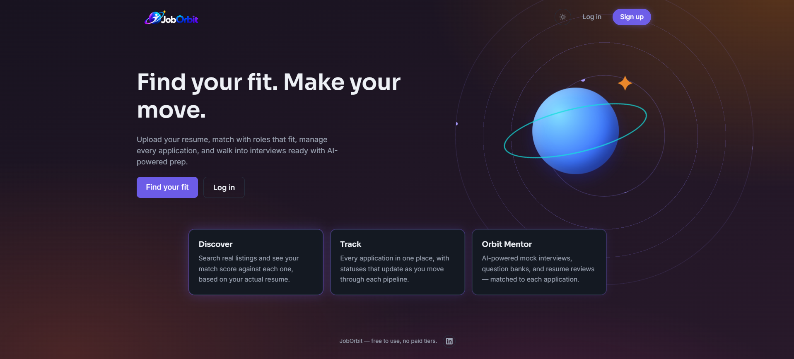
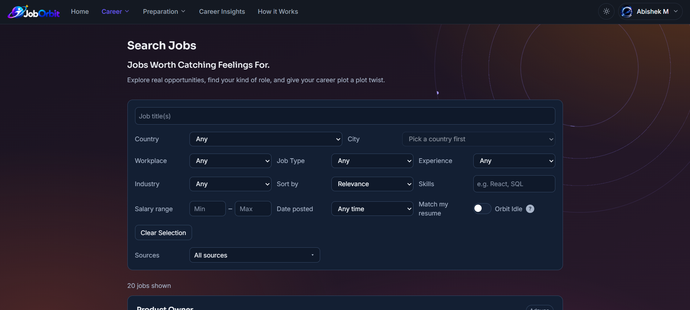
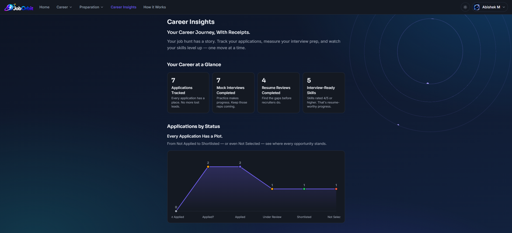
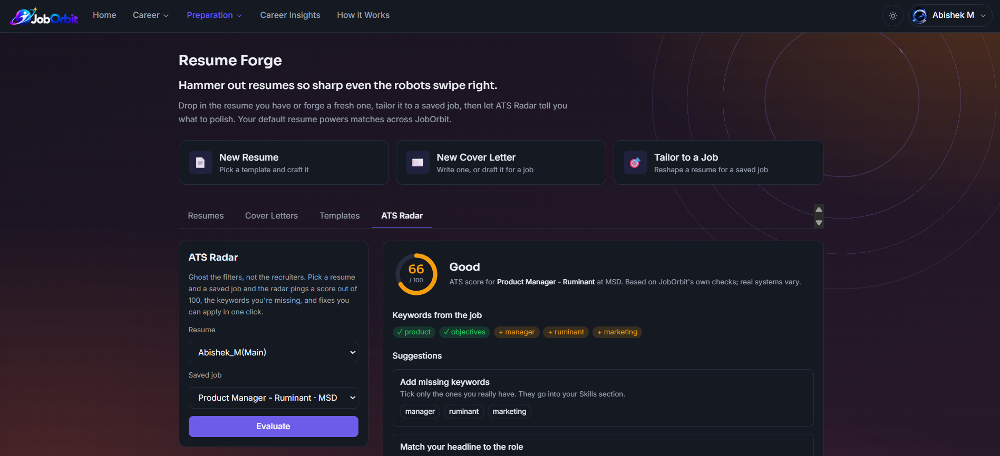
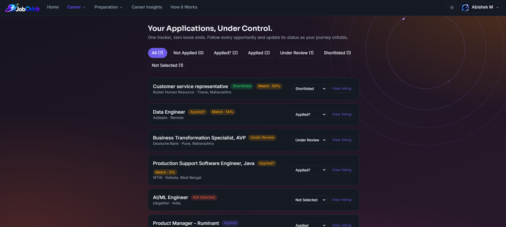
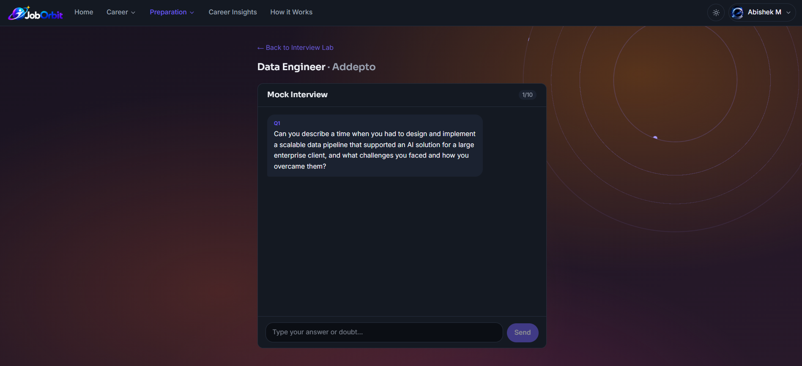
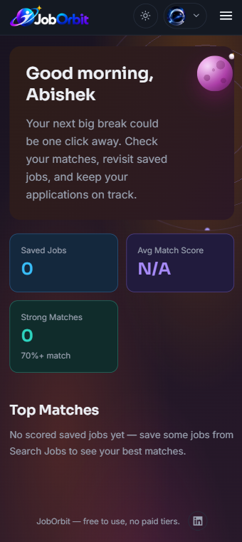

# JobOrbit

**Your whole job search in one place.** Find real listings, see how well your resume fits each one, fix the gaps, track every application, and practice for the interview.

🔗 **Live app:** https://joborbit-smoky.vercel.app
💻 **Code:** https://github.com/Shadow-Monarch28/jobOrbit



---

## Why I built it

Job hunting felt like a second full-time job: one tab for listings, another for the resume, a spreadsheet for applications, a separate tool to check ATS, and the same nightly question, "am I actually a fit for this role?" JobOrbit puts all of that in one app.

It is a portfolio project for my freelance web development work, but it is fully functional: real login, a real database, real job data, and an AI coach. Nothing is mocked.

---

## Features

### Discovery
Live listings pulled from seven sources, filterable by country, city, job type, salary and more. Non-English postings are translated to English.



### Career insights
[Add one line describing what Career insights shows.]



### Resume builder and ATS evaluator
Fix the gaps, tailor the resume to a specific job, and generate a cover letter. The ATS evaluator checks how your resume reads to automated filters.



### Application tracker
Every application in one place, from Applied to Shortlisted. The status is your own record, not a claim about what an employer decided.



### Mock interview
Practice questions for the specific role you are applying to.



### Everything else
- Email and password authentication
- Dark and light mode
- Responsive, works on mobile



---

## Tech stack

| Layer | Tool |
|---|---|
| Frontend | React, Vite, Tailwind CSS |
| Auth and database | Supabase |
| AI coach | Groq |
| Hosting | Vercel |

---

## Run it locally

1. **Clone the repo**
   ```bash
   git clone https://github.com/Shadow-Monarch28/jobOrbit.git
   cd jobOrbit
   ```
2. **Install dependencies**
   ```bash
   npm install
   ```
3. **Add environment variables.** Create a `.env` file in the project root and fill in the values listed in `.env.example` (Supabase project URL and key, Groq API key, and any job-source keys).
4. **Start the dev server**
   ```bash
   npm run dev
   ```
5. **Build for production**
   ```bash
   npm run build
   ```

---

## Deployment

Deployed on Vercel, connected to this GitHub repo. Every push to `main` redeploys automatically. Environment variables are set in the Vercel project settings, not committed to the repo.

---

## Notes

- Job data comes from permitted APIs and feeds only. No scraping.
- Free to use.

---

## Author

**Abishek M**, freelance web developer.
Open to freelance projects: reach me on [LinkedIn](https://www.linkedin.com/in/abishek28m/).
